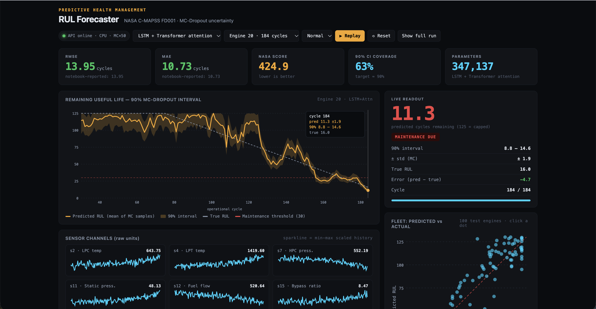
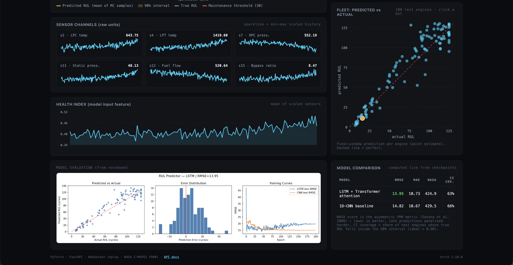
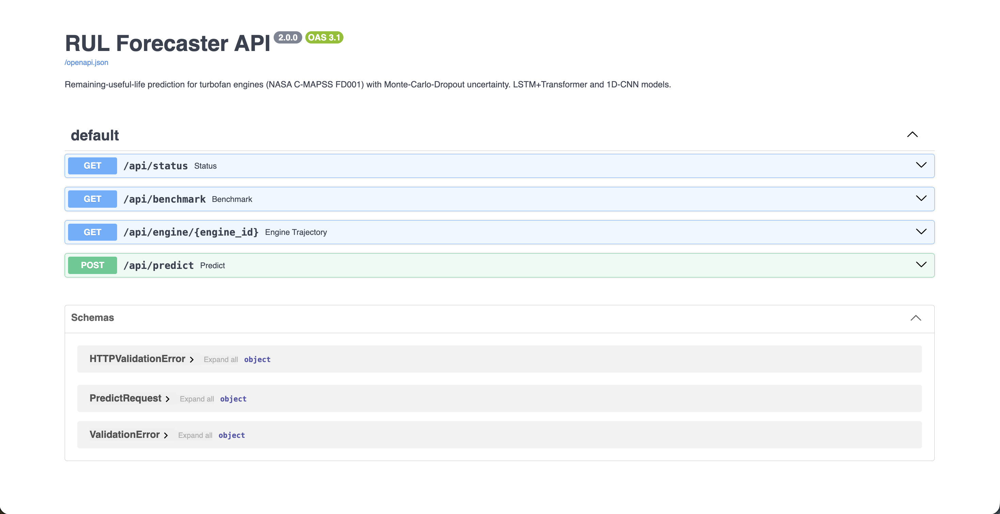
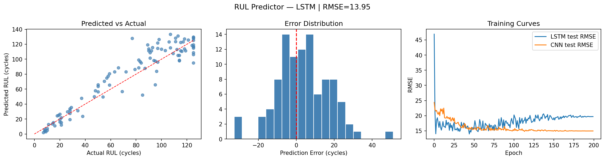

# Remaining Useful Life (RUL) Forecaster
### Deep Learning · Predictive Maintenance · NASA C-MAPSS · FastAPI Dashboard

Predicts how many operational cycles a jet engine has left before failure from the last 30 cycles of sensor data, and serves the models through a **FastAPI backend with a live dashboard** (WebSocket replay, Monte-Carlo-Dropout uncertainty bands, fleet-level evaluation).




---

## What's in the dashboard

| Panel | What it shows |
|---|---|
| **KPI row** | RMSE / MAE / NASA score / 90 % CI coverage, **computed live** from the saved checkpoints on the 100 C-MAPSS FD001 test engines (next to the notebook-reported values) |
| **RUL chart** | Per-cycle predicted RUL, true RUL and the 90 % MC-Dropout interval, streamed cycle-by-cycle over a WebSocket |
| **Live readout** | Current prediction, interval, std, error, status badge (NOMINAL / WATCH / MAINTENANCE DUE at ≤ 30 cycles) |
| **Sensor channels** | Six key sensors with live sparklines (raw units) |
| **Health Index** | The composite feature fed to the model |
| **Fleet scatter** | Predicted vs actual RUL for all 100 test engines — click a dot to replay that engine |
| **Model comparison** | LSTM + Transformer vs 1D-CNN, side by side |

Switch between models, pick any of the 100 test engines, change replay speed, or hit **Show full run** to load a whole trajectory at once via REST.

---

## Quick start (VS Code)

**Prerequisites:** Python 3.10+ and VS Code with the Python extension.

1. Open the project folder in VS Code (`File → Open Folder…` → `rul-forecaster`).
2. Open a terminal: **Ctrl + `** (Cmd + ` on macOS).
3. Create and activate a virtual environment:

   ```bash
   # macOS / Linux
   python3 -m venv .venv
   source .venv/bin/activate
   ```
   ```powershell
   # Windows (PowerShell)
   python -m venv .venv
   .venv\Scripts\Activate.ps1
   # if activation is blocked:  Set-ExecutionPolicy -Scope Process Bypass
   ```
4. Select the interpreter: **Ctrl/Cmd + Shift + P → "Python: Select Interpreter" → `.venv`**.
5. Install dependencies and download the dataset (~12 MB):

   ```bash
   pip install -r requirements.txt
   python scripts/download_data.py
   ```
6. Start the server **from the project root**:

   ```bash
   uvicorn api.server:app --reload --port 8000
   ```
   (or press **F5** and pick *RUL Dashboard (uvicorn)* — a launch config is included)
7. Open **http://127.0.0.1:8000** — the dashboard starts replaying Engine 1 automatically.
   Interactive API docs are at **http://127.0.0.1:8000/docs**.

**Verify everything works** (in a second terminal, server running):

```bash
python scripts/smoke_test.py
```
It checks the API, loads both checkpoints, and confirms the live metrics match the notebook's reported RMSE.

### Troubleshooting
| Symptom | Fix |
|---|---|
| Banner: *Dataset not found* | `python scripts/download_data.py` — if it fails, download `CMAPSSData.zip` from [NASA](https://data.nasa.gov/dataset/cmapss-jet-engine-simulated-data) (or Kaggle), unzip, and copy `train_FD001.txt`, `test_FD001.txt`, `RUL_FD001.txt` into `data/raw/` |
| `CERTIFICATE_VERIFY_FAILED` on macOS | `pip install certifi` and re-run the download script |
| `ModuleNotFoundError: api` | Run `uvicorn` from the project root, not from inside `api/` |
| Banner: *Cannot reach the API* | Server isn't running — step 6 |
| Slow first load | First request computes the benchmark for both models (a few seconds on CPU); results are cached |
| `pip install torch` is slow/huge | CPU-only build: `pip install torch --index-url https://download.pytorch.org/whl/cpu` |

### Screenshots used in this README
Saved in `assets/screenshots/` (three images):
1. **`dashboard_overview.png`** — KPI row, RUL chart with the 90 % interval, live readout and sensor channels (use an engine with 150+ cycles and click **Show full run**).
2. **`dashboard_evaluation.png`** — fleet scatter (predicted vs actual), health index and the LSTM-vs-CNN comparison table.
3. **`api_docs.png`** — the auto-generated FastAPI Swagger page at `/docs`.

---

## API



| Method | Endpoint | Description |
|---|---|---|
| GET | `/` | Dashboard UI |
| GET | `/docs` | Swagger UI |
| GET | `/api/status` | Device, dataset and checkpoint availability |
| GET | `/api/benchmark` | RMSE, MAE, NASA score, 90 % CI coverage and per-engine predictions for both models |
| GET | `/api/engine/{id}?arch=lstm\|cnn&mc_samples=50` | Full MC-Dropout trajectory for one test engine |
| POST | `/api/predict` | One 30 × 15 window → `rul_mean`, `rul_std`, `ci_lower_90`, `ci_upper_90` |
| WS | `/ws/replay/{id}?arch=&interval=&start=` | Streams the engine's run cycle-by-cycle |

```bash
curl -X POST http://127.0.0.1:8000/api/predict \
  -H "Content-Type: application/json" \
  -d "{\"arch\": \"lstm\", \"sequence\": $(python -c 'print([[0.5]*15]*30)')}"
```

**How uncertainty works.** Dropout stays active at inference; each window is passed through the model 50 times (`mc_samples`), and the mean, standard deviation and 5th/95th percentiles of the samples give the prediction and 90 % interval (Gal & Ghahramani, 2016). The dashboard reports how often the true RUL actually falls inside that interval (*CI coverage*) so the bands can be judged rather than just admired.

---

## Dataset

**NASA C-MAPSS — Turbofan Engine Degradation Simulation (FD001)**

- 100 training engines (20,631 rows), 100 test engines (one RUL label each), 21 sensor channels → 14 informative ones kept
- RUL capped at 125 cycles (piecewise-linear labelling, Saxena et al. 2008)
- Test labels are capped at 125 as well. The raw `RUL_FD001.txt` labels go above 125; without capping them, test RMSE sits at 32–38 whatever you train. This was the main data-pipeline bug.

Reference: Saxena et al. (2008), *Damage Propagation Modeling for Aircraft Engine Run-to-Failure Simulation*, PHM Conference.

---

## Models

**LSTM + Transformer attention** — input: sliding window of 30 cycles × 15 features (14 sensors + health index)

```
Input (30 × 15)
  → 2-layer LSTM (hidden 128, dropout 0.2)
  → Transformer encoder (1 layer, 4 heads, FFN 256)
  → mean pooling → Linear(128→64) → ReLU → Dropout → Linear(64→1)
```

**1D-CNN baseline** — three Conv1d blocks (64 → 128 → 128 channels) + ReLU, global average pooling, same regression head. Trains roughly 2–3× faster.

**Health Index** — weighted average of the 14 scaled sensors, weights = |Pearson correlation with RUL| (NASA PHM-style HI construction).

The authoritative model definitions are in [`api/nets.py`](api/nets.py) (identical to the notebook).

---

## Results (C-MAPSS FD001, 100 test engines)

| Model | RMSE (cycles) | MAE (cycles) | NASA score ↓ | 90 % CI coverage |
|---|---|---|---|---|
| LSTM + Attention | **13.95** | 10.73 | 424.9 | 63 % |
| 1D-CNN | 14.82 | 10.67 | 429.5 | 66 % |
| Literature baseline (LSTM) | 12–18 | — | — | — |

RMSE / MAE match the notebook; the dashboard recomputes all columns live from the saved checkpoints (`scripts/smoke_test.py` asserts the RMSE match). The two models are close: the LSTM is slightly more accurate by RMSE, the CNN is marginally better on MAE and trains faster.

**Uncertainty:** the 90 % MC-Dropout intervals contain the true RUL for only 63–66 % of test engines, so they are **overconfident** (too narrow) and not yet calibrated.



**Reading the plots**

- **Predicted vs actual (left):** predictions follow the diagonal and are tightest at low RUL (0–40 cycles), the safety-critical region. At high RUL (80–125) many points sit *above* the line, i.e. the model tends to **over-predict** remaining life for healthy engines.
- **Error distribution (centre):** errors = predicted − actual, roughly centred on zero with a heavier positive tail (up to about +50 cycles). Positive error means "more life than reality", which is the risky direction for maintenance planning — the NASA score penalises it more heavily for this reason.
- **Training curves (right):** the LSTM reaches its best test RMSE (~14) within the first few epochs and then drifts up to ~20 as it overfits, while the CNN improves steadily to ~15. See limitations below.

---

## Known limitations (read before quoting the numbers)

- **Checkpoint selection used the test set.** The notebook keeps the epoch with the lowest *test* RMSE, so 13.95 is an optimistic, best-epoch figure rather than a held-out estimate. A clean protocol would select on a validation split of the training engines (split by engine, not by row) and report the test set once.
- **Hence the LSTM's late-epoch RMSE is ~20,** not 13.95. The saved LSTM checkpoint is the early best epoch.
- **Health-index mismatch.** In training the HI uses correlation weights; at test time (no RUL column) the notebook falls back to an unweighted sensor mean. The dashboard reproduces this so the reported numbers are reproducible, but it is a train/test inconsistency worth fixing.
- **MC-Dropout intervals are under-dispersed.** Measured coverage is 63 % (LSTM) / 66 % (CNN) against the 90 % target; the bands show relative uncertainty but should not be read as calibrated probabilities.
- **FD001 only** — one operating condition and one fault mode; the easiest subset.
- **Dashboard replays held-out test engines** (data on disk streamed at a fixed pace); it is not connected to a live sensor feed.

---

## Reproducing training

Training lives in [`rul_predictor_full.ipynb`](rul_predictor_full.ipynb) (Colab, T4 GPU, ~25 min total):

1. Open the notebook in Google Colab, set runtime to **T4 GPU**.
2. Run cells top to bottom (the dataset downloads automatically).
3. Download `lstm_rul.pth` and `cnn_rul.pth` and put them in `checkpoints/`.

Expected final output:
```
LSTM  — RMSE: 13.95 | MAE: 10.73
CNN1D — RMSE: 14.82 | MAE: 10.67
```

---

## Project structure

```
rul-forecaster/
├── api/
│   ├── server.py            # FastAPI app: REST + WebSocket + serves the dashboard
│   ├── nets.py              # LSTM+Transformer and CNN models, MC-Dropout inference
│   ├── pipeline.py          # C-MAPSS preprocessing (scaler, health index, windows)
│   └── static/index.html    # dashboard (vanilla JS + SVG, no build step, works offline)
├── checkpoints/             # lstm_rul.pth, cnn_rul.pth
├── data/raw/                # C-MAPSS files (downloaded by scripts/download_data.py)
├── scripts/
│   ├── download_data.py
│   └── smoke_test.py
├── assets/                  # eval_results.png, screenshots/
├── rul_predictor_full.ipynb # training + evaluation notebook
├── legacy/                  # earlier drafts (not used by the dashboard)
└── requirements.txt
```

## Stack

PyTorch (LSTM, TransformerEncoder, Conv1d) · FastAPI + Uvicorn (REST, WebSocket) · NumPy / pandas / scikit-learn · Weights & Biases (training) · vanilla JS + SVG (dashboard)

## Next steps

- Select checkpoints on a validation split and re-report the metrics
- Fix the train/test health-index inconsistency
- Extend to FD002 / FD004 (six operating conditions) — where the LSTM-vs-CNN gap should widen
- Calibrate the MC-Dropout intervals (measured coverage is 63–66 % vs the 90 % target — e.g. conformal calibration on a validation split)
- Replace the file replay with a real streaming source
